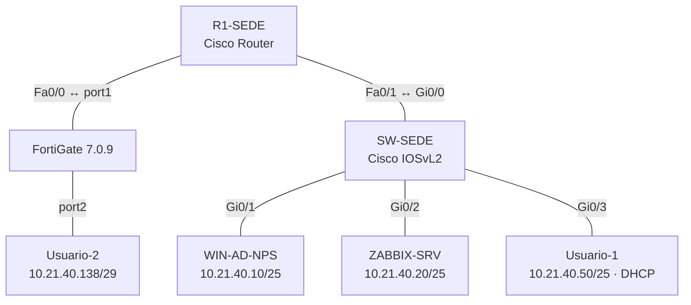

# Parcial 2 — Seguridad de Redes en GNS3

**Segundo parcial · Laboratorio de redes y seguridad · GNS3 · Cisco IOS / IOSvL2 · FortiGate 7.0.9 · Windows Server · Ubuntu Server 24.04.5 · Zabbix 7.0**

## 🎬 Video demostrativo

**Pendiente de publicación.** El enlace de YouTube de la demostración (duración máxima 10 minutos) se incorporará aquí, al principio del README, antes de la entrega.

---

## 1. Introducción y objetivos

Este laboratorio integra una red principal Cisco y una red remota FortiGate mediante **VPN Site-to-Site IPsec**, junto con DHCP, administración SSH, autenticación centralizada **AAA/RADIUS**, monitoreo **SNMP/Zabbix** y medidas de **hardening inspiradas en CIS**.

Los objetivos son:

1. Construir una topología funcional en GNS3, asignando direcciones derivadas de `10.21.40.0`.
2. Asignar IP dinámica al primer cliente mediante el servicio DHCP de R1.
3. Administrar router y switch por SSH con cuentas locales, sin habilitar Telnet.
4. Proteger el tráfico entre las LAN de Cisco y FortiGate mediante IPsec, y comprobar que deja de pasar cuando se desactiva el túnel.
5. Monitorear el switch desde Zabbix por SNMP de solo lectura restringido.
6. Integrar Windows Server AD DS/NPS para AAA/RADIUS, con registro de accesos aceptados y rechazados.
7. Documentar controles de endurecimiento y evidencias originales.

## 2. Topología de red

La **captura auténtica de GNS3** ya fue suministrada durante la práctica; está pendiente de cargarse como `Topologia/Topologia.png`. No se incrusta todavía para evitar enlaces de imagen rotos.



[Documentación detallada de la topología y conexiones](Topologia/README.md)

### Direccionamiento principal

| Dispositivo / interfaz | IPv4 | Función |
|---|---|---|
| R1-SEDE, FastEthernet0/1 | `10.21.40.1/25` | Puerta de enlace LAN principal |
| R1-SEDE, FastEthernet0/0 | `10.21.40.129/30` | Enlace a FortiGate |
| SW-SEDE, VLAN 1 | `10.21.40.2/25` | Gestión y SNMP |
| WIN-AD-NPS | `10.21.40.10/25` | AD DS, DNS y NPS |
| ZABBIX-SRV, ens3 | `10.21.40.20/25` | Monitoreo |
| Usuario-1 | `10.21.40.50/25` | Cliente DHCP |
| FortiGate, port1 | `10.21.40.130/30` | Enlace Cisco |
| FortiGate, port2 | `10.21.40.137/29` | Puerta de enlace LAN remota |
| Usuario-2 | `10.21.40.138/29` | Cliente de LAN remota |

**Subredes:** LAN principal `10.21.40.0/25`; tránsito Cisco–FortiGate `10.21.40.128/30`; LAN remota `10.21.40.136/29`.

[Consultar direccionamiento completo y pruebas de conectividad](Direccionamiento/README.md).

## 3. Router R1-SEDE — DHCP, SSH, AAA y VPN

### 3.1 Interfaces y DHCP

```cisco
interface FastEthernet0/1
 description LAN_PRINCIPAL
 ip address 10.21.40.1 255.255.255.128
!
interface FastEthernet0/0
 description ENLACE_FORTIGATE
 ip address 10.21.40.129 255.255.255.252
 crypto map VPN-MAP
!
ip dhcp excluded-address 10.21.40.1 10.21.40.49
ip dhcp pool LAN-USUARIOS
 network 10.21.40.0 255.255.255.128
 default-router 10.21.40.1
 dns-server 8.8.8.8
```

**Pruebas:** `show ip dhcp binding` y `ipconfig /all`; Usuario-1 obtuvo `10.21.40.50`.

### 3.2 SSH y AAA

```cisco
aaa new-model
aaa authentication login default group radius local
aaa authorization exec default group radius local
aaa accounting exec default start-stop group radius
ip ssh version 2
line vty 0 4
 exec-timeout 5 0
 transport input ssh
```

NPS está en `10.21.40.10`, con autenticación UDP 1812 y contabilidad UDP 1813. Se verificó el acceso con `adminradius` y actividad de AAA.

### 3.3 Rutas y selectores VPN

```cisco
ip route 10.21.40.136 255.255.255.248 10.21.40.130
access-list 110 permit ip 10.21.40.0 0.0.0.127 10.21.40.136 0.0.0.7
```

La configuración de IKE/IPsec y el peer FortiGate constan en el archivo del equipo. **No se reproduce la clave precompartida**.

[Ver running-config de R1](Show%20running-config/Show%20running-config%20R1-Sede.txt).

## 4. Switch SW-SEDE — SSH y SNMP

```cisco
interface Vlan1
 description ADMINISTRACION_SWITCH
 ip address 10.21.40.2 255.255.255.128
!
ip default-gateway 10.21.40.1
access-list 10 permit 10.21.40.20
snmp-server community <COMUNIDAD_PRIVADA> RO 10
ip ssh version 2
line vty 0 4
 exec-timeout 5 0
 login local
 transport input ssh
```

Los puertos `Gi0/1`, `Gi0/2` y `Gi0/3` conectan respectivamente Windows Server, Zabbix y Usuario-1; `Gi0/0` enlaza con R1. Se comprobó SSH y el cierre de Telnet, y Zabbix recibió datos por SNMP con la ACL 10.

[Ver running-config del switch](Show%20running-config/Show%20running-config%20SW-Sede.txt).

## 5. FortiGate 7.0.9 — VPN IPsec

La configuración se realizó en la **interfaz gráfica de FortiGate**. El túnel `VPN-CISCO` une `10.21.40.0/25` y `10.21.40.136/29`, mediante IKEv1 y ESP. Por limitaciones del laboratorio se negociaron algoritmos heredados **DES/SHA-1 y DH2**, no apropiados para producción.

**Comprobaciones observadas:**

- **VPN activa:** monitor IPsec en `Up`, R1 con `QM_IDLE` y contadores ESP mayores que cero; ping entre Usuario-1 y Usuario-2 exitoso.
- **VPN desactivada:** `Bring Down` en GUI y pérdida de comunicación durante la comprobación.
- **VPN restablecida:** `Bring Up` y recuperación de respuestas ICMP.

[Configuración FortiGate](Configuracion%20FortiGate/README.md) · [Pruebas detalladas de IPsec](Documentacion/VPN-IPsec.md).

## 6. Ubuntu Server — instalación y monitoreo Zabbix

El servidor `ZABBIX-SRV` ejecuta **Ubuntu Server 24.04.5, Zabbix 7.0 LTS, MariaDB y Apache**. En la GUI de Zabbix, el host `SW-SEDE` se supervisó por SNMPv2c sobre UDP 161.

```bash
sudo systemctl is-active mariadb zabbix-server zabbix-agent apache2
snmpget -v2c -c '<COMUNIDAD_PRIVADA>' 10.21.40.2 1.3.6.1.2.1.1.5.0
```

**Resultado:** servicios `active`; SNMP disponible en verde; datos de `System name`, `System contact`, `System location` y `Uptime`.

[Configuración Zabbix](Configuracion%20Zabbix/README.md) · [Comandos de instalación del servidor Ubuntu](Scripts/ZABBIX-SRV_Instalacion_Config.txt) · [SNMP detallado](Documentacion/Zabbix-SNMP.md).

## 7. Windows Server — Active Directory, NPS y RADIUS

El servidor `WIN-AD-NPS` (`10.21.40.10`) aloja el dominio `parcial.test` y el servicio NPS. Se habilitó el cliente RADIUS R1 y la política `ACCESO-SSH-CISCO`, con atributo administrativo compatible con el IOS utilizado.

| Verificación | Resultado |
|---|---|
| Acceso SSH a R1 mediante usuario `adminradius` | Correcto |
| NPS, evento **6272** | Solicitud autorizada |
| NPS, evento **6273** | Solicitud denegada |
| Comandos `show aaa servers` / `show aaa user all` | Solicitudes y sesiones registradas |

[Configuración Windows Server](Configuracion%20Windows%20Server/README.md) · [AAA y auditoría](Documentacion/AAA-RADIUS-Windows-Server.md).

## 8. Hardening — medidas inspiradas en CIS

Se documentaron `no ip source-route`, desactivación de HTTP/HTTPS administrativos, SSHv2 y VTY sin Telnet, cierre de sesión remota a cinco minutos, autenticación local y restricción SNMP con ACL. También se identificaron limitaciones pendientes: hashes tipo 5, VLAN 1, SNMPv2c, algoritmos IPsec antiguos y advertencia de negociación de dúplex en interfaces virtuales.

**No se declara cumplimiento total CIS.** [Ver medidas, comandos y limitaciones](Documentacion/Hardening-CIS.md).

## 9. Evidencias y resultados

Las pruebas del laboratorio se realizaron, pero **las capturas originales todavía deben incorporarse como archivos dentro del repositorio**. No se incluyen imágenes inexistentes ni se presentan reconstrucciones como capturas.

| Prueba | Lugar de verificación | Resultado |
|---|---|---|
| Topología física | Lienzo de GNS3 | Dispositivos y enlaces visibles |
| DHCP | Usuario-1 y R1 | `10.21.40.50` asignada |
| SSH / Telnet | R1 y SW | SSH funcional y Telnet no habilitado |
| VPN activa | FortiGate y R1 | `Up`, `QM_IDLE`, ping exitoso |
| VPN desconectada | FortiGate y Windows | `Inactive`, ping sin respuesta |
| VPN restaurada | FortiGate y Windows | Comunicación recuperada |
| Zabbix | GUI y terminal Ubuntu | Estado SNMP verde y métricas |
| AAA/RADIUS | NPS y R1 | Eventos 6272/6273 y actividad AAA |
| CIS | Running-config y comandos IOS | Controles implementados documentados |

📷 [Abrir el inventario y las instrucciones para integrar las capturas](Evidencias/README.md).

## 10. Conclusiones

Se consiguió conectar dos redes de laboratorio mediante IPsec y demostrar la dependencia del túnel para el tráfico entre usuarios; además se verificaron direccionamiento, DHCP, SSH, disponibilidad SNMP en Zabbix y autenticación AAA/RADIUS con eventos aceptados y rechazados. Las limitaciones de versiones y algoritmos se consignan explícitamente, sin atribuir al entorno una seguridad de producción.

## 11. Archivos del proyecto

| Carpeta | Contenido |
|---|---|
| [Topologia](Topologia/README.md) | Topología, conexiones y ubicación de capturas |
| [Direccionamiento](Direccionamiento/README.md) | Plan completo de IP y pruebas |
| [Show running-config](Show%20running-config) | Configuraciones Cisco R1 y SW |
| [Scripts](Scripts/ZABBIX-SRV_Instalacion_Config.txt) | Instalación Ubuntu/Zabbix |
| [Configuracion Zabbix](Configuracion%20Zabbix/README.md) | Resumen del servidor y monitoreo |
| [Configuracion Windows Server](Configuracion%20Windows%20Server/README.md) | AD DS, DNS, NPS |
| [Configuracion FortiGate](Configuracion%20FortiGate/README.md) | VPN GUI e IPsec |
| [Documentacion](Documentacion/Entrega-y-video.md) | VPN, AAA, SNMP, CIS y requisitos de entrega |
| [Evidencias](Evidencias/README.md) | Capturas auténticas pendientes de integrar |

**Entrega:** [guion del video y comprobaciones finales](Documentacion/Entrega-y-video.md).

> **Seguridad de la publicación:** las copias Cisco visibles ya fueron depuradas para ocultar hashes y secretos de VPN, RADIUS y SNMP. **Como esos valores estuvieron publicados en versiones anteriores, deben rotarse y podrían seguir accesibles en el historial de Git.**

**Última actualización documental:** 11 de noviembre de 2026.
