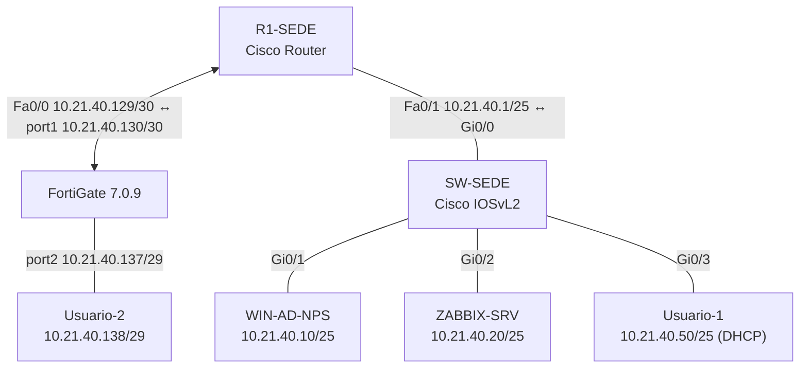

# Parcial 2 — Seguridad de Redes en GNS3

**Video de demostración (máximo 10 minutos): pendiente de publicar.** Se agregará aquí el enlace directo a YouTube antes de la entrega.

Laboratorio de seguridad y administración de red desarrollado en GNS3 con **Cisco IOS, Cisco IOSvL2, FortiGate 7.0.9, Windows Server con AD DS/NPS, Ubuntu Server con Zabbix y dos clientes**. La documentación distingue configuraciones observadas, pruebas ejecutadas y evidencias que todavía deben incorporarse al repositorio.

## Topología lógica

La VPN IPsec conecta de forma lógica la LAN **10.21.40.0/25** con la LAN remota **10.21.40.136/29**, usando el enlace **10.21.40.128/30** entre R1 y FortiGate. El diagrama lógico no sustituye la captura auténtica de la topología de GNS3 requerida como evidencia.

## Estructura del repositorio

| Recurso | Contenido |
|---|---|
| [Direccionamiento](Direccionamiento/README.md) | Plan de IP, subredes, conexiones físicas y comprobaciones |
| [Show running-config — R1](Show%20running-config/Show%20running-config%20R1-Sede.txt) | Configuración Cisco del router |
| [Show running-config — SW](Show%20running-config/Show%20running-config%20SW-Sede.txt) | Configuración Cisco del switch |
| [Script de Ubuntu/Zabbix](Scripts/ZABBIX-SRV_Instalacion_Config.txt) | Procedimiento de instalación y monitoreo |
| [VPN IPsec](Documentacion/VPN-IPsec.md) | Selectores, políticas y pruebas de túnel |
| [Active Directory y RADIUS](Documentacion/AAA-RADIUS-Windows-Server.md) | NPS, AAA Cisco y registros de acceso |
| [SNMP y Zabbix](Documentacion/Zabbix-SNMP.md) | Servidor de monitoreo, ACL y validación |
| [Endurecimiento](Documentacion/Hardening-CIS.md) | Controles inspirados en CIS y limitaciones |
| [Evidencias](Evidencias/README.md) | Inventario de capturas auténticas por adjuntar |
| [Entrega y video](Documentacion/Entrega-y-video.md) | Guion de demostración y lista de verificación |

## Requisitos y resultados

| Criterio | Implementación / comprobación | Estado documental |
|---|---|---|
| VPN Cisco–FortiGate | ISAKMP `QM_IDLE`, SAs ESP y ping entre redes; interrupción al bajar túnel en GUI | Verificado; faltan capturas en GitHub |
| DHCP desde router | Pool `LAN-USUARIOS` y concesión `10.21.40.50` | Verificado; falta captura en GitHub |
| SSH seguro frente a Telnet | SSHv2 en R1/SW; prueba de puerto 23 fallida | Verificado; falta captura en GitHub |
| Direccionamiento y conectividad | IP de 10.21.40.0 y pruebas LAN | Documentado |
| SNMP de switch hacia Zabbix | ACL que limita origen a `10.21.40.20`; disponibilidad SNMP y datos | Verificado; falta captura en GitHub |
| Endurecimiento basado en CIS | Servicios HTTP deshabilitados, SSH y límites de sesión | Documentado con excepciones |
| AAA/RADIUS y auditoría | NPS en Windows Server, eventos 6272 y 6273, registros AAA Cisco | Verificado; falta captura en GitHub |
| Documentación, imágenes y video | Estructura de contenidos publicada | **Pendiente:** subir imágenes auténticas y enlace del video |

## Comprobaciones centrales

- **VPN activa:** `show crypto isakmp sa` en estado `QM_IDLE`; `show crypto ipsec sa` con contadores de encapsulación/decapsulación; ping de Usuario-1 a Usuario-2 exitoso.
- **VPN desactivada:** desde FortiGate GUI se llevó el túnel a `Inactive` y se verificó pérdida de comunicación; al restablecerlo retornó la conectividad.
- **AAA:** acceso remoto autorizado mediante `adminradius` y eventos de NPS **6272** (aceptado) y **6273** (rechazado).
- **Zabbix:** servicios MariaDB, Apache, Zabbix Server y Agent activos; switch visible por SNMP con datos reales.
- **Servicios de administración:** acceso SSH; Telnet no habilitado en las líneas VTY de R1/SW.

## Seguridad y alcance

Este es un **laboratorio académico**, no un diseño listo para producción. El IOS antiguo y el FortiGate sin licencia limitaron los algoritmos IPsec a DES/SHA-1/DH2; además existen configuraciones heredadas (SNMPv2c, hashes tipo 5, VLAN 1). Los controles descritos son **inspirados en CIS**, no certificación de cumplimiento del benchmark. Se recomienda sustituir claves reales por valores redactados en cualquier `running-config` público y rotar secretos que ya se hayan publicado.

**Fecha de documentación:** 11 de noviembre de 2026.
