# Parcial 2 — Seguridad de Redes en GNS3

**Segundo parcial · Laboratorio de redes y seguridad · GNS3 · Cisco IOS / IOSvL2 · FortiGate 7.0.9 · Windows Server · Ubuntu Server 24.04.5 · Zabbix 7.0**

## 🎬 Video demostrativo

▶️ **[Ver demostración del Segundo Parcial en YouTube](https://www.youtube.com/watch?v=1PUEc_N8MYw)**

---

## 1. Introducción y objetivos

Este laboratorio integra una red principal Cisco y una red remota FortiGate mediante **VPN Site-to-Site IPsec**, junto con DHCP, administración SSH, autenticación centralizada **AAA/RADIUS**, monitoreo **SNMP/Zabbix** y medidas de **hardening inspiradas en CIS**.

Los objetivos son:

1. Construir una topología funcional en GNS3, asignando direcciones derivadas de `10.21.40.0`.
2. Asignar IP dinámica al primer cliente mediante el servicio DHCP de R1.
3. Administrar router y switch por SSH con cuentas locales, sin habilitar Telnet.
4. Proteger el tráfico entre las LAN de Cisco y FortiGate mediante IPsec, y comprobar que deja de pasar cuando se desactiva el túnel.
5. Monitorear el switch desde Zabbix por SNMP de solo lectura restringido.
6. Integrar Windows Server AD DS/NPS para AAA/RADIUS, con registro de accesos aceptados y rechazados.
7. Documentar controles de endurecimiento y evidencias originales.

## 2. Topología de red

**Captura auténtica del proyecto GNS3:**

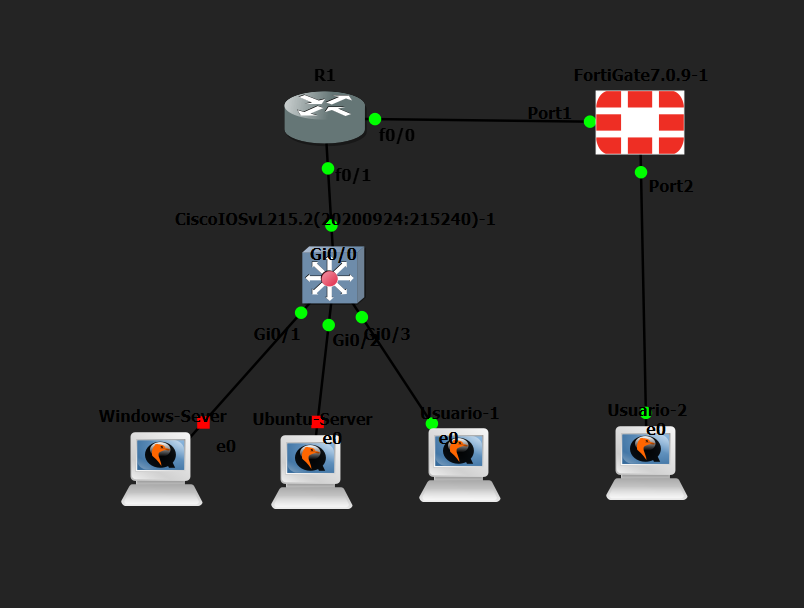

**Diagrama complementario:**

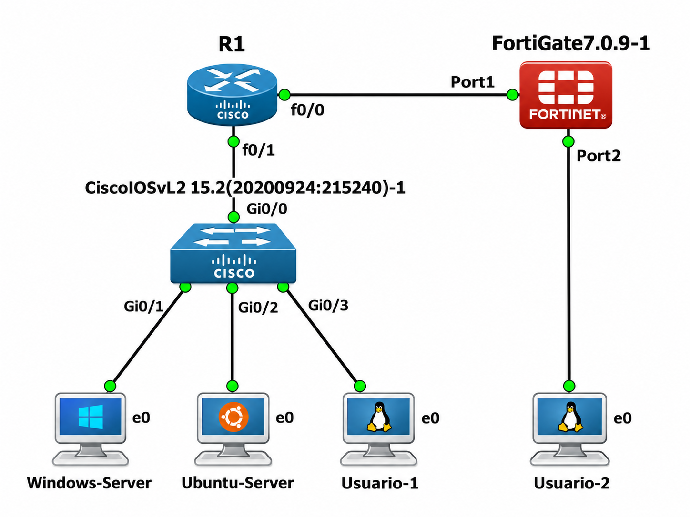

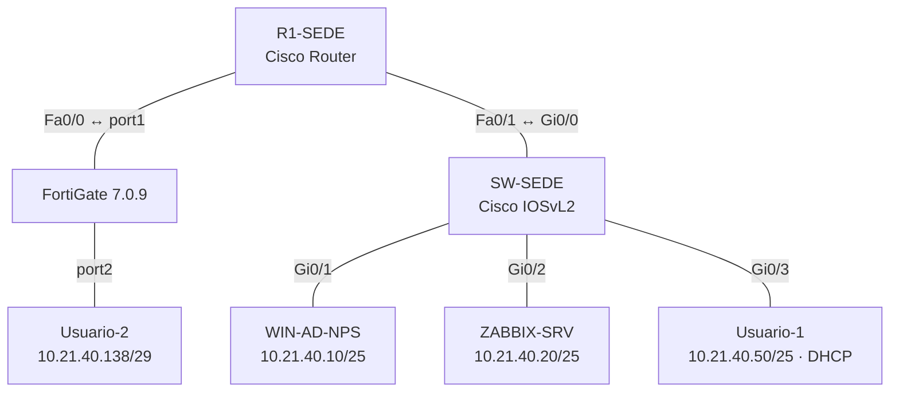

[Ver las imágenes de topología](Topologia)

### Direccionamiento principal

| Dispositivo / interfaz | IPv4 | Función |
|---|---|---|
| R1-SEDE, FastEthernet0/1 | `10.21.40.1/25` | Puerta de enlace LAN principal |
| R1-SEDE, FastEthernet0/0 | `10.21.40.129/30` | Enlace a FortiGate |
| SW-SEDE, VLAN 1 | `10.21.40.2/25` | Gestión y SNMP |
| WIN-AD-NPS | `10.21.40.10/25` | AD DS, DNS y NPS |
| ZABBIX-SRV, ens3 | `10.21.40.20/25` | Monitoreo |
| Usuario-1 | `10.21.40.50/25` | Cliente DHCP |
| FortiGate, port1 | `10.21.40.130/30` | Enlace Cisco |
| FortiGate, port2 | `10.21.40.137/29` | Puerta de enlace LAN remota |
| Usuario-2 | `10.21.40.138/29` | Cliente de LAN remota |

**Subredes:** LAN principal `10.21.40.0/25`; tránsito Cisco–FortiGate `10.21.40.128/30`; LAN remota `10.21.40.136/29`.

[Consultar direccionamiento completo y pruebas de conectividad](Direccionamiento/README.md).

## 3. Router R1-SEDE — DHCP, SSH, AAA y VPN

### 3.1 Interfaces y DHCP

```cisco
interface FastEthernet0/1
 description LAN_PRINCIPAL
 ip address 10.21.40.1 255.255.255.128
!
interface FastEthernet0/0
 description ENLACE_FORTIGATE
 ip address 10.21.40.129 255.255.255.252
 crypto map VPN-MAP
!
ip dhcp excluded-address 10.21.40.1 10.21.40.49
ip dhcp pool LAN-USUARIOS
 network 10.21.40.0 255.255.255.128
 default-router 10.21.40.1
 dns-server 8.8.8.8
```

**Pruebas:** `show ip dhcp binding` y `ipconfig /all`; Usuario-1 obtuvo `10.21.40.50`.

### 3.2 SSH y AAA

```cisco
aaa new-model
aaa authentication login default group radius local
aaa authorization exec default group radius local
aaa accounting exec default start-stop group radius
ip ssh version 2
line vty 0 4
 exec-timeout 5 0
 transport input ssh
```

NPS está en `10.21.40.10`, con autenticación UDP 1812 y contabilidad UDP 1813. Se verificó el acceso con `adminradius` y actividad de AAA.

### 3.3 Rutas y selectores VPN

```cisco
ip route 10.21.40.136 255.255.255.248 10.21.40.130
access-list 110 permit ip 10.21.40.0 0.0.0.127 10.21.40.136 0.0.0.7
```

La configuración de IKE/IPsec y el peer FortiGate constan en el archivo del equipo. **No se reproduce la clave precompartida**.

[Ver running-config de R1](Show%20running-config/Show%20running-config%20R1-Sede.txt).

## 4. Switch SW-SEDE — SSH y SNMP

```cisco
interface Vlan1
 description ADMINISTRACION_SWITCH
 ip address 10.21.40.2 255.255.255.128
!
ip default-gateway 10.21.40.1
access-list 10 permit 10.21.40.20
snmp-server community <COMUNIDAD_PRIVADA> RO 10
ip ssh version 2
line vty 0 4
 exec-timeout 5 0
 login local
 transport input ssh
```

Los puertos `Gi0/1`, `Gi0/2` y `Gi0/3` conectan respectivamente Windows Server, Zabbix y Usuario-1; `Gi0/0` enlaza con R1. Se comprobó SSH y el cierre de Telnet, y Zabbix recibió datos por SNMP con la ACL 10.

[Ver running-config del switch](Show%20running-config/Show%20running-config%20SW-Sede.txt).

## 5. FortiGate 7.0.9 — VPN IPsec

La configuración se realizó en la **interfaz gráfica de FortiGate**. El túnel `VPN-CISCO` une `10.21.40.0/25` y `10.21.40.136/29`, mediante IKEv1 y ESP. Por limitaciones del laboratorio se negociaron algoritmos heredados **DES/SHA-1 y DH2**, no apropiados para producción.

**Comprobaciones observadas:**

- **VPN activa:** monitor IPsec en `Up`, R1 con `QM_IDLE` y contadores ESP mayores que cero; ping entre Usuario-1 y Usuario-2 exitoso.
- **VPN desactivada:** `Bring Down` en GUI y pérdida de comunicación durante la comprobación.
- **VPN restablecida:** `Bring Up` y recuperación de respuestas ICMP.

**Documentación y evidencia:** [Informe Word de VPN IPsec](Configuracion%20FortiGate/Evidencias_VPN_IPsec.docx).

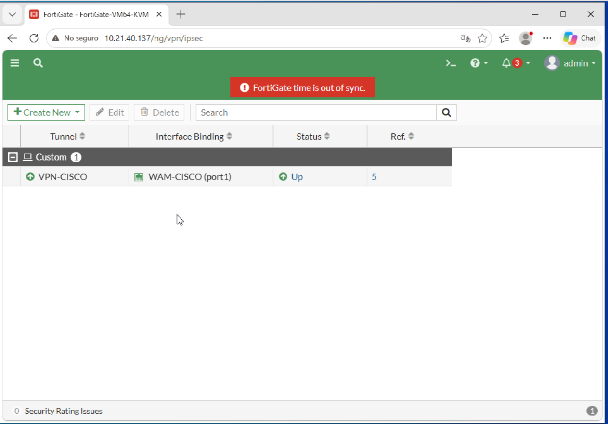

*Figura. VPN-CISCO en estado activo.*

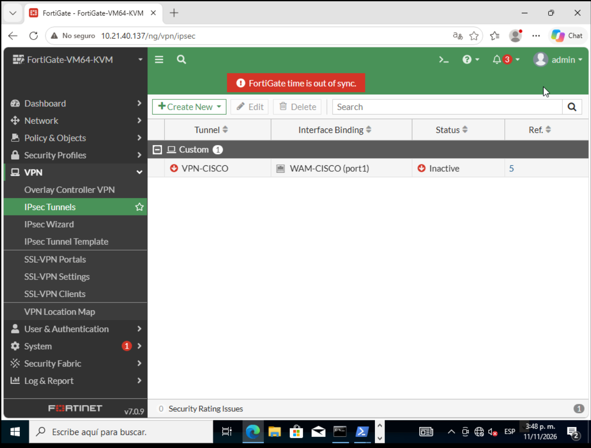

*Figura. VPN-CISCO desactivada desde la interfaz gráfica.*

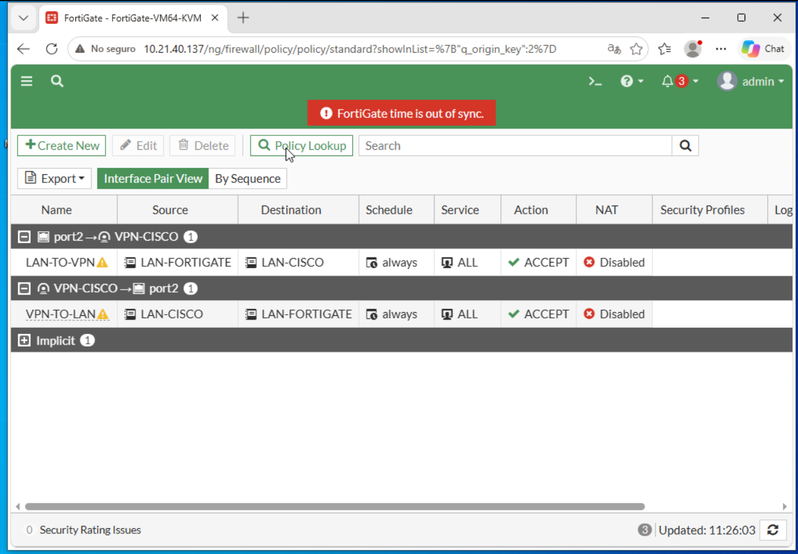

*Figura. Políticas de firewall de FortiGate.*

## 6. Ubuntu Server — instalación y monitoreo Zabbix

El servidor `ZABBIX-SRV` ejecuta **Ubuntu Server 24.04.5, Zabbix 7.0 LTS, MariaDB y Apache**. En la GUI de Zabbix, el host `SW-SEDE` se supervisó por SNMPv2c sobre UDP 161.

```bash
sudo systemctl is-active mariadb zabbix-server zabbix-agent apache2
snmpget -v2c -c '<COMUNIDAD_PRIVADA>' 10.21.40.2 1.3.6.1.2.1.1.5.0
```

**Resultado:** servicios `active`; SNMP disponible en verde; datos de `System name`, `System contact`, `System location` y `Uptime`.

**Documentación y evidencias:** [Informe Word Zabbix/SNMP](Configuracion%20Zabbix/Evidencias_Zabbix_SNMP.docx) · [Comandos de instalación Ubuntu](Scripts/ZABBIX-SRV_Instalacion_Config.txt).

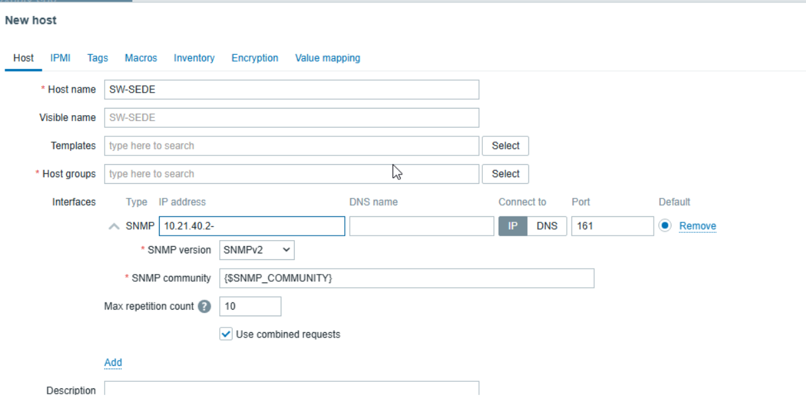

*Figura. Disponibilidad SNMP del switch.*

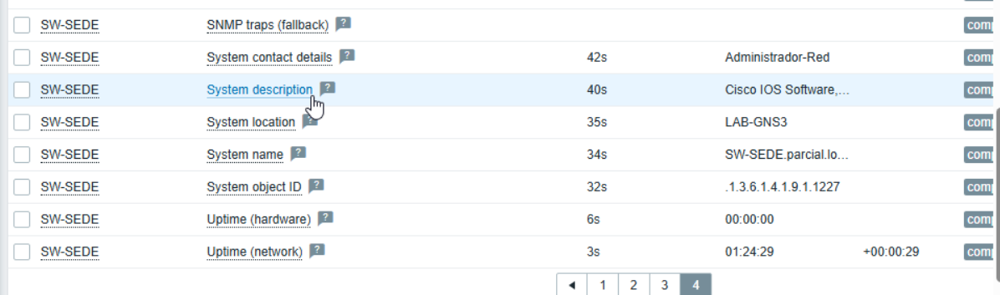

*Figura. Datos recopilados mediante SNMP.*

[Ver captura adicional del host](Evidencias/Zabbix/Zabbix-Host.png).

## 7. Windows Server — Active Directory, NPS y RADIUS

El servidor `WIN-AD-NPS` (`10.21.40.10`) aloja el dominio `parcial.test` y el servicio NPS. Se habilitó el cliente RADIUS R1 y la política `ACCESO-SSH-CISCO`, con atributo administrativo compatible con el IOS utilizado.

| Verificación | Resultado |
|---|---|
| Acceso SSH a R1 mediante usuario `adminradius` | Correcto |
| NPS, evento **6272** | Solicitud autorizada |
| NPS, evento **6273** | Solicitud denegada |
| Comandos `show aaa servers` / `show aaa user all` | Solicitudes y sesiones registradas |

**Documentación y evidencias:** [Informe Word de Windows Server — AD DS/NPS](Configuracion%20Windows%20Server/Evidencias_Windows_Server_AD_NPS.docx) · [Versión sin líneas de fuente](Evidencias/Evidencias_Windows_Server_AD_NPS_Sin_Fuentes.docx).

<details>
<summary><strong>Ver las 15 capturas originales de Windows Server</strong></summary>

**Captura WS-01**

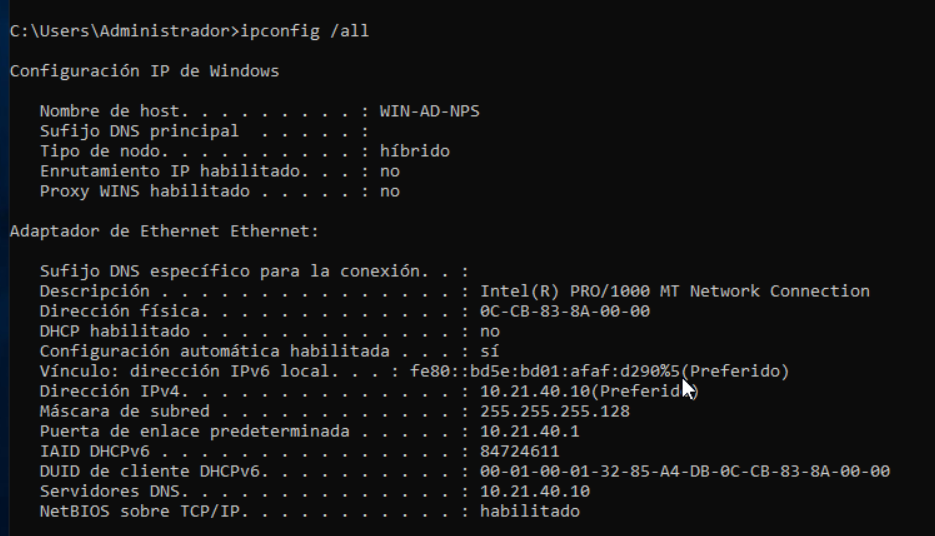

**Captura WS-02**

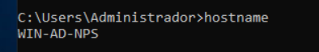

**Captura WS-03**

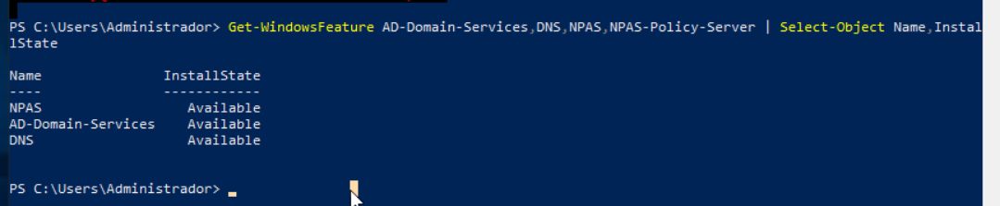

**Captura WS-04**

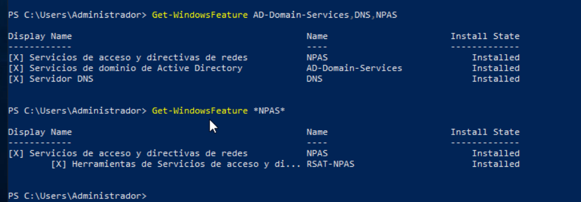

**Captura WS-05**

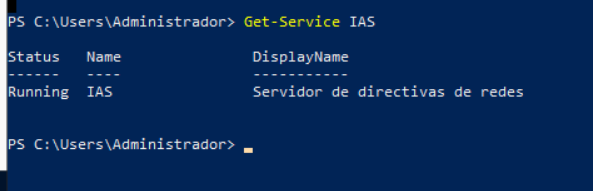

**Captura WS-06**

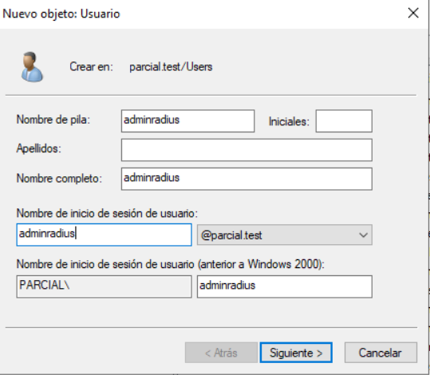

**Captura WS-07**

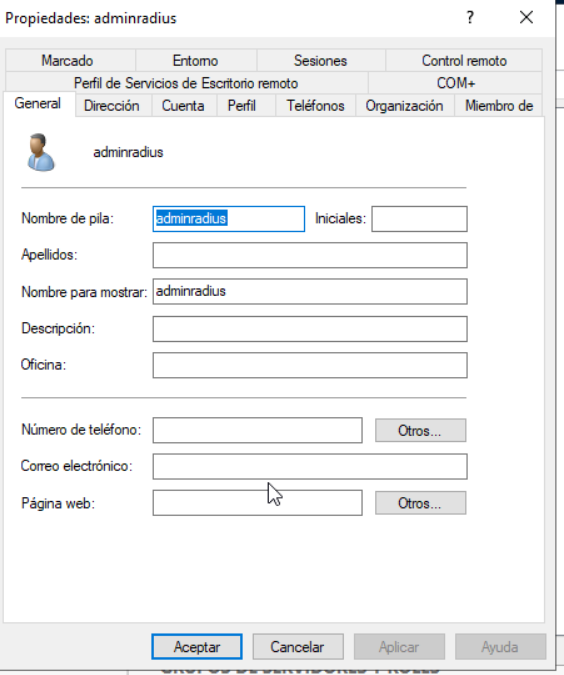

**Captura WS-08**

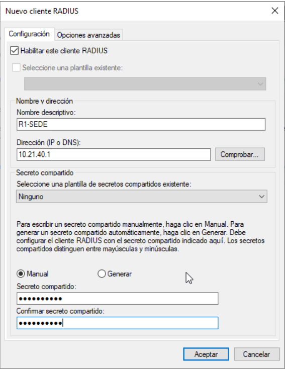

**Captura WS-09**

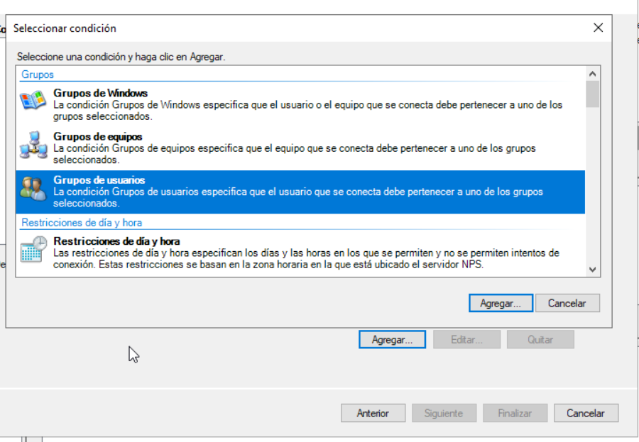

**Captura WS-10**

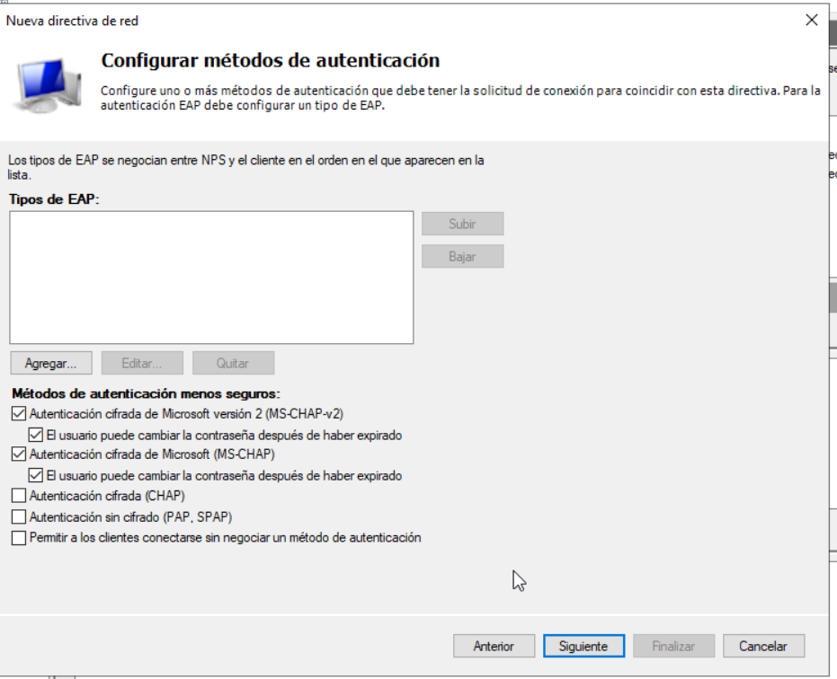

**Captura WS-11**

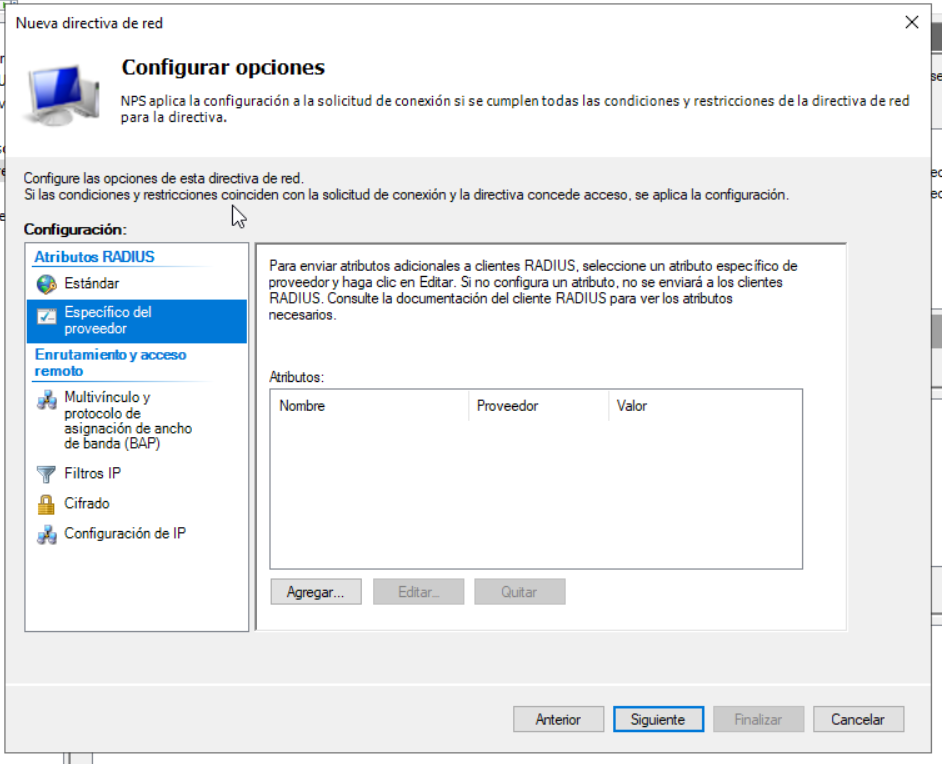

**Captura WS-12**

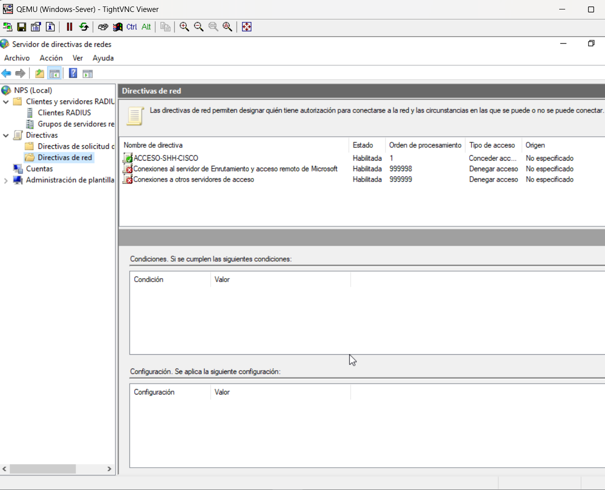

**Captura WS-13**

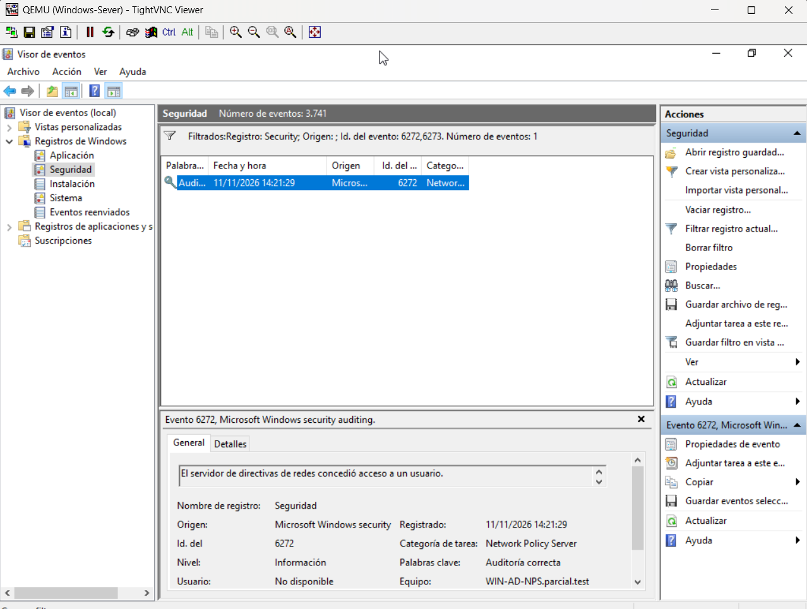

**Captura WS-14**

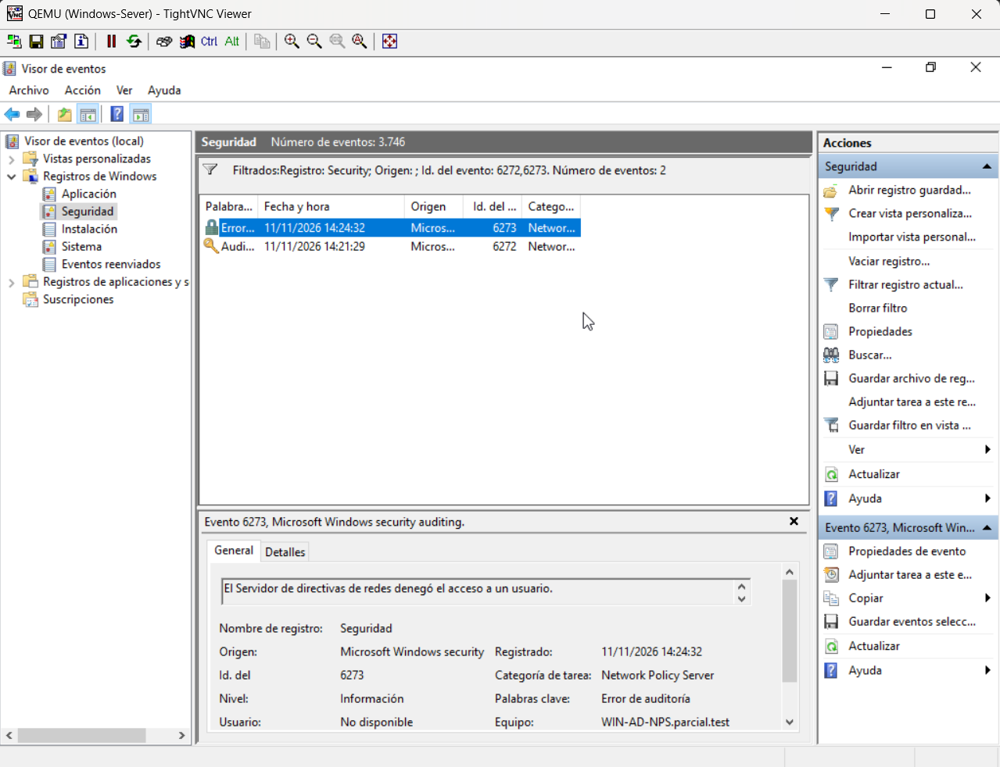

**Captura WS-15**

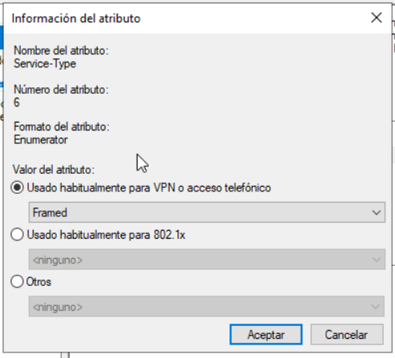

</details>

Las imágenes muestran distintas etapas de configuración y comprobación de Windows Server. Para las descripciones detalladas, consultar el informe Word correspondiente.

## 8. Hardening — medidas inspiradas en CIS

Se documentaron `no ip source-route`, desactivación de HTTP/HTTPS administrativos, SSHv2 y VTY sin Telnet, cierre de sesión remota a cinco minutos, autenticación local y restricción SNMP con ACL. También se identificaron limitaciones pendientes: hashes tipo 5, VLAN 1, SNMPv2c, algoritmos IPsec antiguos y advertencia de negociación de dúplex en interfaces virtuales.

**No se declara cumplimiento total CIS.** Los controles pueden contrastarse con los [running-config de R1 y SW](Show%20running-config). Para completar la evaluación documental faltan capturas individuales de los comandos de hardening.

(Configuracion%20FortiGate/Evidencias_VPN_IPsec.docx) |
| SNMP/Zabbix | Switch disponible y datos actuales | [SNMP](Evidencias/Zabbix/Zabbix-SNMP.png), [Latest data](Evidencias/Zabbix/Zabbix-Latest-Data.png), [Host](Evidencias/Zabbix/Zabbix-Host.png) |
| AAA/RADIUS | NPS registró autenticaciones admitidas y denegadas; AAA Cisco operativo | [15 capturas Windows](Evidencias/Windows-Server), [informe Word](Configuracion%20Windows%20Server/Evidencias_Windows_Server_AD_NPS.docx); **pendiente captura específica de `show aaa servers`** |
| Hardening CIS | SSHv2, HTTP deshabilitado, VTY temporizadas, ACL SNMP | Configuraciones Cisco; **pendientes capturas directas de comandos** |

Las imágenes de FortiGate muestran el estado del túnel en momentos distintos de la prueba; no deben interpretarse como estados simultáneos. Las capturas son auténticas y los diagramas complementarios se presentan como material explicativo.

[Explorar la carpeta completa de evidencias](Evidencias) · [Consultar el inventario](Evidencias/README.md)

---

