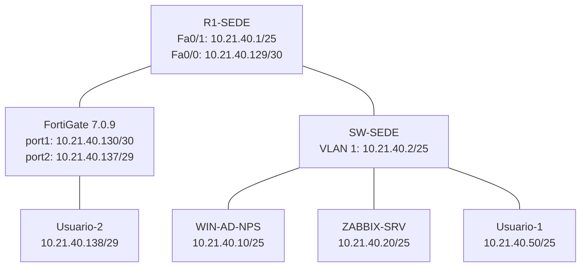

# Topología del laboratorio — Segundo parcial

## Diagrama y captura de GNS3

El laboratorio utiliza el router **R1-SEDE**, el switch **SW-SEDE**, un **FortiGate 7.0.9**, un servidor Windows **WIN-AD-NPS**, un servidor Ubuntu **ZABBIX-SRV** y dos clientes.

La captura auténtica del lienzo de GNS3 recibida durante la práctica está disponible en la conversación y debe almacenarse en esta carpeta como `Topologia.png`. El diagrama complementario puede guardarse como `Diagrama.png`; se debe indicar que es un diagrama esquemático, no una captura de GNS3. **Los archivos gráficos todavía no se han incorporado aquí**.

## Conexiones físicas

| Dispositivo origen | Puerto | Dispositivo destino | Puerto |
|---|---|---|---|
| R1-SEDE | FastEthernet0/0 | FortiGate | port1 |
| R1-SEDE | FastEthernet0/1 | SW-SEDE | GigabitEthernet0/0 |
| SW-SEDE | GigabitEthernet0/1 | WIN-AD-NPS | e0 |
| SW-SEDE | GigabitEthernet0/2 | ZABBIX-SRV | e0 / ens3 |
| SW-SEDE | GigabitEthernet0/3 | Usuario-1 | e0 |
| FortiGate | port2 | Usuario-2 | e0 |

## Esquema lógico

**VPN:** `10.21.40.0/25` ↔ `10.21.40.136/29`.

Para el plan de redes y las pruebas de conectividad, consultar [Direccionamiento](../Direccionamiento/README.md).
